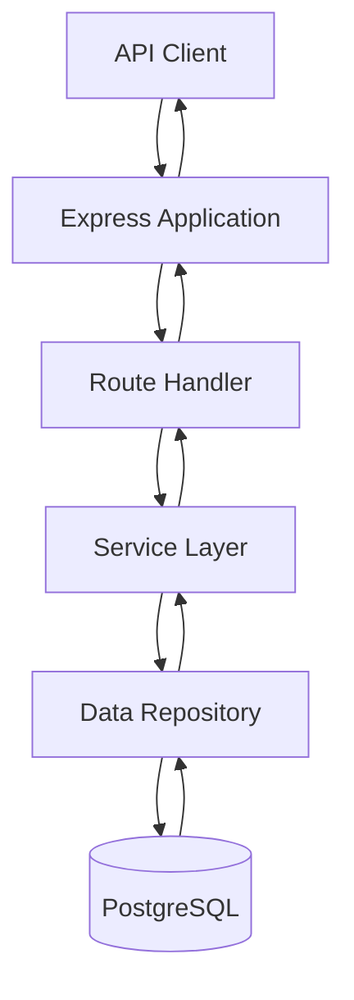

# Backend Architecture

## 1. Overview

The Library Management System is the library module of the College Management System. Its backend provides a REST API built with Node.js and Express.

The API supports book management, library student and faculty records, registrar student records, loans, reservations, fines, and finance payments.

Most application data is stored in PostgreSQL. The Registrar module currently uses an in-memory data source. The API contract is documented in `server/openapi.yaml`, and Swagger UI is available at `/docs` when the backend is running.

## 2. Technology Stack

| Technology | Purpose |
|---|---|
| Node.js | JavaScript runtime for the backend |
| Express 5 | HTTP server and API routing |
| PostgreSQL | Relational database for most application data |
| `pg` | PostgreSQL client |
| CORS | Enables cross-origin requests |
| dotenv | Loads environment variables |
| YAML | Parses the OpenAPI specification |
| Swagger UI Express | Serves interactive API documentation |
| Nodemon | Restarts the server during development |

The backend uses CommonJS modules.

## 3. Backend Structure

The main backend structure is:

```text
server/
|-- src/
|   |-- config/
|   |   `-- database.js
|   |-- data/
|   |   |-- books.repository.js
|   |   |-- libraryStudents.repository.js
|   |   |-- libraryFaculty.repository.js
|   |   |-- registrar.repository.js
|   |   |-- loans.repository.js
|   |   |-- reservations.repository.js
|   |   |-- fines.repository.js
|   |   `-- financePayments.repository.js
|   |-- routes/
|   |   |-- books.routes.js
|   |   |-- libraryStudents.routes.js
|   |   |-- libraryFaculty.routes.js
|   |   |-- registrar.routes.js
|   |   |-- loans.routes.js
|   |   |-- reservations.routes.js
|   |   |-- fines.routes.js
|   |   `-- financePayments.routes.js
|   |-- services/
|   |   |-- bookService.js
|   |   |-- libraryStudents.service.js
|   |   |-- libraryFaculty.service.js
|   |   |-- registrar.service.js
|   |   |-- loanService.js
|   |   |-- reservations.service.js
|   |   |-- fines.service.js
|   |   `-- financePayments.service.js
|   `-- index.js
|-- openapi.yaml
`-- package.json
```

### Responsibilities

- **Configuration (`config/`)**: Configures the PostgreSQL database connection.
- **Routes (`routes/`)**: Defines API endpoints and handles incoming HTTP requests.
- **Services (`services/`)**: Contains application logic used by the API.
- **Data repositories (`data/`)**: Handles data access for the application's modules.
- **Application entry point (`index.js`)**: Configures Express, middleware, API routes, Swagger UI, and server startup.
- **OpenAPI specification (`openapi.yaml`)**: Describes the documented API endpoints and operations.

## 4. Request Flow and Application Startup

### Request flow



The diagram shows the general route-service-repository pattern used by the backend. The Registrar module is an exception to the usual PostgreSQL data source because it currently uses in-memory data.

### Startup sequence

1. The application loads environment variables and initializes Express.
2. CORS and JSON request-body middleware are registered.
3. The application loads `server/openapi.yaml` and configures Swagger UI.
4. The API routes and health endpoint are registered.
5. The application tests the PostgreSQL connection with a query.
6. If the database connection succeeds, the server starts listening on the configured port. If the connection fails, the error is logged and the server does not start listening.

The default port is `5000`, configurable through the `PORT` environment variable.

### Main URLs

| URL | Purpose |
|---|---|
| `/` | Confirms that the API application is running |
| `/api/v1/health` | Returns the API health response |
| `/docs` | Opens the Swagger UI documentation |
| `/api/v1` | Base path for the documented version 1 API endpoints |

The health endpoint currently returns `{"status":"ok"}`. This response should not be interpreted as a separate database health check.

## 5. Frontend Structure and API Integration

### 5.1 Overview

The frontend is a React application built with Vite. It provides the user interface for the Library Management System, including dashboard analytics, book catalog management, student and faculty directories, borrowing, returns, reservations, fines, reports, and system settings.

The frontend communicates with the Express backend through Axios. Shared authentication and library data are managed using React Context.

### 5.2 Technology Stack

| Technology | Purpose |
|---|---|
| React | Builds the user interface using reusable components |
| Vite | Frontend development server and build tool |
| React Router | Handles client-side navigation and protected routes |
| Axios | Sends HTTP requests to the backend API |
| Lucide React | Provides interface icons |
| Motion | Supports interface animations |
| CSS | Defines global styles, layouts, variables, and responsive behavior |

### 5.3 Frontend Structure

The main frontend source directory is `client/src/`.

```text
client/
|-- src/
|   |-- assets/              # Frontend assets
|   |-- components/          # Reusable interface components
|   |   |-- books/
|   |   |-- common/
|   |   |-- dashboard/
|   |   |-- faculty/
|   |   |-- layout/
|   |   `-- students/
|   |-- context/
|   |   |-- AuthContext.jsx
|   |   `-- LibraryContext.jsx
|   |-- hooks/               # Custom React hooks
|   |-- pages/               # Application screens
|   |   |-- auth/
|   |   `-- ...
|   |-- routes/
|   |   `-- AppRoutes.jsx
|   |-- services/
|   |   |-- api.js
|   |   |-- libraryApi.js
|   |   `-- libraryService.js
|   |-- styles/
|   |-- App.jsx
|   `-- main.jsx
|-- .env.example
|-- package.json
`-- vite.config.ts
```

#### Main responsibilities

- **Pages (`pages/`)**: Contains the application screens for the different library functions.
- **Components (`components/`)**: Contains reusable interface elements such as modals, tables, pagination, status badges, and layout components.
- **Context (`context/`)**: Manages shared authentication and library application state.
- **Routes (`routes/`)**: Defines application navigation and access restrictions.
- **Services (`services/`)**: Handles API communication, data transformation, and local settings storage.
- **Styles (`styles/`)**: Contains global CSS variables, layout rules, and responsive styles.
- **Entry point (`main.jsx`)**: Mounts the React application and imports the global stylesheets.
- **Application component (`App.jsx`)**: Configures BrowserRouter, AuthProvider, LibraryProvider, and AppRoutes.

### 5.4 Application Pages

The current frontend contains the following page files:

| Page | File | Purpose |
|---|---|---|
| Login | `pages/auth/Login.jsx` | Provides user login |
| Register | `pages/auth/Register.jsx` | Displays the registration interface; self-registration is currently unavailable |
| Dashboard | `pages/Dashboard.jsx` | Displays library dashboard information |
| Books | `pages/Books.jsx` | Manages the book catalog |
| Categories | `pages/Categories.jsx` | Manages catalog categories |
| Students | `pages/Students.jsx` | Displays library student records |
| Faculty | `pages/Faculty.jsx` | Displays library faculty records |
| Borrowing | `pages/Borrowing.jsx` | Manages book loans |
| Returns | `pages/Returns.jsx` | Displays and processes returned books |
| Reservations | `pages/Reservations.jsx` | Manages book reservations |
| Fines | `pages/Fines.jsx` | Manages library fines |
| Reports | `pages/Reports.jsx` | Displays library reports |
| Settings | `pages/Settings.jsx` | Manages library settings |
| Staff Management | `pages/StaffManagement.jsx` | Provides staff management functions |

### 5.5 Navigation and Route Protection

The application uses React Router through `AppRoutes.jsx`.

| Route | Access |
|---|---|
| `/login` | Public |
| `/register` | Public |
| `/dashboard` | Authenticated users |
| `/students` | Authenticated users |
| `/faculty` | Authenticated users |
| `/books` | Authenticated users |
| `/categories` | Authenticated users |
| `/borrowing` | Authenticated users |
| `/returns` | Authenticated users |
| `/reservations` | Authenticated users |
| `/fines` | Authenticated users |
| `/reports` | Authenticated users |
| `/settings` | Authenticated users |
| `/staff-management` | Admin only |

The root route (`/`) redirects to `/dashboard`.

The `ProtectedRoute` component checks authentication before displaying protected pages. Unauthenticated users are redirected to `/login`. Users who do not have the required `ADMIN` role are redirected to `/dashboard` when accessing staff management.

### 5.6 Authentication and Session Management

Authentication is managed by `AuthContext.jsx` through the `AuthProvider`.

The frontend uses the backend authentication endpoints:

| HTTP method | Endpoint | Purpose |
|---|---|---|
| POST | `/auth/login` | Authenticates a user and obtains a JWT |
| GET | `/auth/me` | Verifies the stored authentication token |

The frontend stores authenticated user information and the JWT using the browser's `localStorage` or `sessionStorage`, depending on the Remember Me selection.

The shared Axios client attaches the stored JWT as a Bearer token to API requests.

Self-registration is currently unavailable through the frontend because the current backend integration does not expose a public registration endpoint.

### 5.7 Frontend Services

The frontend uses three service files:

| File | Responsibility |
|---|---|
| `services/api.js` | Configures Axios, the API base URL, request headers, JWT attachment, and API error handling |
| `services/libraryApi.js` | Handles library API requests and transforms backend records into frontend data formats |
| `services/libraryService.js` | Loads, saves, and resets library settings using browser local storage |

The default API base URL configured in `api.js` is:

```text
http://localhost:5000/api
```

This value can be overridden through the `VITE_API_BASE_URL` environment variable.

### 5.8 Shared Library State

`LibraryContext.jsx` provides shared library data and operations through `LibraryProvider` and the `useLibrary` hook.

The context manages:

- Books
- Categories
- Students
- Faculty
- Borrowing records
- Returns
- Reservations
- Fines
- Payments
- Library settings
- Loading and backend connection status
- Notifications and global search

On application startup, the context checks the backend health endpoint and attempts to load the library data.

Some functions have specific implementation limitations:

- Categories are derived from book records and managed in frontend state.
- Returns are derived from loan records.
- Student and faculty records are read-only in the current frontend integration.
- Reservation status updates are not supported by the current API integration.
- Fine payments are submitted through the Finance API.
- Library settings are stored locally in the browser rather than through a backend settings endpoint.

### 5.9 Frontend API Mapping

The following table describes the endpoint paths currently called by `libraryApi.js`. These paths are relative to the configured Axios base URL.

| Functional area | HTTP method | Endpoint path | Purpose |
|---|---|---|---|
| Health check | GET | `/v1/health` | Checks backend availability |
| Authentication | POST | `/auth/login` | Authenticates a user |
| Authentication | GET | `/auth/me` | Verifies the current user |
| Books | GET | `/books` | Retrieves book records |
| Books | POST | `/books` | Creates a book record |
| Books | PUT | `/books/{bookId}` | Updates a book record |
| Books | DELETE | `/books/{bookId}` | Deletes a book record |
| Students | GET | `/registrar/students` | Retrieves registrar student records |
| Students | GET | `/library/students` | Fallback source for student records |
| Faculty | GET | `/library/faculty` | Retrieves faculty records |
| Loans | GET | `/loans` | Retrieves loan records |
| Loans | POST | `/loans` | Creates a loan |
| Loans | PUT | `/loans/{loanId}` | Updates a loan, including returns |
| Loans | DELETE | `/loans/{loanId}` | Deletes a loan |
| Reservations | GET | `/reservations` | Retrieves reservations |
| Reservations | POST | `/reservations` | Creates a reservation |
| Reservations | DELETE | `/reservations/{reservationId}` | Deletes a reservation |
| Fines | GET | `/fines` | Retrieves fines |
| Fines | POST | `/fines` | Creates a fine |
| Fines | PUT | `/fines/{fineId}` | Updates fine status |
| Finance | GET | `/finance/payments` | Retrieves payment records |
| Finance | POST | `/finance/payments` | Processes a fine payment |

The endpoint paths above describe the frontend implementation. They must be checked against the backend routes and `server/openapi.yaml` before confirming that all integrations are operational.

### 5.10 Integration Notes and Limitations

The frontend and backend must use matching API base paths and endpoint definitions.

The current Axios configuration uses `http://localhost:5000/api` by default. The health check adds `/v1/health`, while most library service requests use unversioned paths such as `/books` and `/loans`.

The backend architecture and OpenAPI documentation describe versioned API paths under `/api/v1`. Therefore, the frontend and backend endpoint mappings require verification with the backend developer.

The frontend also tracks backend availability through `LibraryContext.jsx`. When the health check or data-loading requests fail, the application marks the backend as disconnected and displays an appropriate notification when a server-dependent operation is attempted.

Successful frontend startup does not by itself confirm successful backend connectivity or complete API integration.


## 6. API Conventions and Data Sources

- API endpoints use the `/api/v1` version prefix.
- JSON request bodies are supported through Express JSON middleware.
- Cross-origin requests are enabled through CORS middleware.
- The OpenAPI specification is maintained in `server/openapi.yaml`.
- Most module data is accessed through PostgreSQL repositories.
- Registrar student data currently comes from an in-memory source.

The API contract in `server/openapi.yaml` should be kept consistent with the implemented routes and the data model documented in `docs/data-model.md`.
