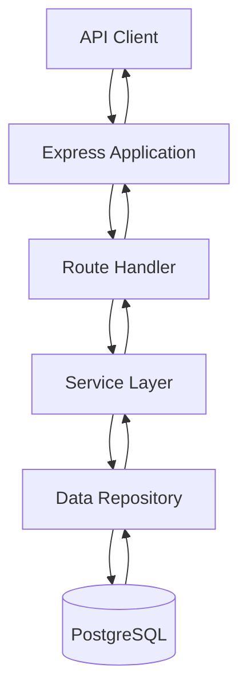

# Backend Architecture

## 1. Overview

The Library Management System is the library module of the College Management System. Its backend provides a REST API built with Node.js and Express.

The API supports book management, library student and faculty records, registrar student records, loans, reservations, fines, and finance payments.

Most application data is stored in PostgreSQL. The Registrar module currently uses an in-memory data source. The API contract is documented in `server/openapi.yaml`, and Swagger UI is available at `/docs` when the backend is running.

## 2. Technology Stack

| Technology | Purpose |
|---|---|
| Node.js | JavaScript runtime for the backend |
| Express 5 | HTTP server and API routing |
| PostgreSQL | Relational database for most application data |
| `pg` | PostgreSQL client |
| CORS | Enables cross-origin requests |
| dotenv | Loads environment variables |
| YAML | Parses the OpenAPI specification |
| Swagger UI Express | Serves interactive API documentation |
| Nodemon | Restarts the server during development |

The backend uses CommonJS modules.

## 3. Backend Structure

The main backend structure is:

```text
server/
|-- src/
|   |-- config/
|   |   `-- database.js
|   |-- data/
|   |   |-- books.repository.js
|   |   |-- libraryStudents.repository.js
|   |   |-- libraryFaculty.repository.js
|   |   |-- registrar.repository.js
|   |   |-- loans.repository.js
|   |   |-- reservations.repository.js
|   |   |-- fines.repository.js
|   |   `-- financePayments.repository.js
|   |-- routes/
|   |   |-- books.routes.js
|   |   |-- libraryStudents.routes.js
|   |   |-- libraryFaculty.routes.js
|   |   |-- registrar.routes.js
|   |   |-- loans.routes.js
|   |   |-- reservations.routes.js
|   |   |-- fines.routes.js
|   |   `-- financePayments.routes.js
|   |-- services/
|   |   |-- bookService.js
|   |   |-- libraryStudents.service.js
|   |   |-- libraryFaculty.service.js
|   |   |-- registrar.service.js
|   |   |-- loanService.js
|   |   |-- reservations.service.js
|   |   |-- fines.service.js
|   |   `-- financePayments.service.js
|   `-- index.js
|-- openapi.yaml
`-- package.json
```

### Responsibilities

- **Configuration (`config/`)**: Configures the PostgreSQL database connection.
- **Routes (`routes/`)**: Defines API endpoints and handles incoming HTTP requests.
- **Services (`services/`)**: Contains application logic used by the API.
- **Data repositories (`data/`)**: Handles data access for the application's modules.
- **Application entry point (`index.js`)**: Configures Express, middleware, API routes, Swagger UI, and server startup.
- **OpenAPI specification (`openapi.yaml`)**: Describes the documented API endpoints and operations.

## 4. Request Flow and Application Startup

### Request flow



The diagram shows the general route-service-repository pattern used by the backend. The Registrar module is an exception to the usual PostgreSQL data source because it currently uses in-memory data.

### Startup sequence

1. The application loads environment variables and initializes Express.
2. CORS and JSON request-body middleware are registered.
3. The application loads `server/openapi.yaml` and configures Swagger UI.
4. The API routes and health endpoint are registered.
5. The application tests the PostgreSQL connection with a query.
6. If the database connection succeeds, the server starts listening on the configured port. If the connection fails, the error is logged and the server does not start listening.

The default port is `5000`, configurable through the `PORT` environment variable.

### Main URLs

| URL | Purpose |
|---|---|
| `/` | Confirms that the API application is running |
| `/api/v1/health` | Returns the API health response |
| `/docs` | Opens the Swagger UI documentation |
| `/api/v1` | Base path for the documented version 1 API endpoints |

The health endpoint currently returns `{"status":"ok"}`. This response should not be interpreted as a separate database health check.

## 5. Frontend Structure and API Mapping

The repository's `client/` directory currently contains only a README file. The frontend implementation and prototype screen source files are not included in this repository. Therefore, the table below maps the documented API capabilities to the corresponding functional UI areas; the exact screen names and screen-to-endpoint connections must be checked against the shared Figma prototype.

All paths in the table are relative to the API base URL `http://localhost:5000/api/v1`.

| Functional UI area | HTTP method | API endpoint | Purpose |
|---|---|---|---|
| Book catalog | GET | `/books` | Retrieve books |
| Book catalog | POST | `/books` | Create a book |
| Book details or editing | GET | `/books/{bookId}` | Retrieve one book |
| Book editing | PUT | `/books/{bookId}` | Update a book |
| Book management | DELETE | `/books/{bookId}` | Delete a book |
| Library student directory | GET | `/library/students` | Retrieve library student records |
| Library student details | GET | `/library/students/{studentId}` | Retrieve one library student |
| Library faculty directory | GET | `/library/faculty` | Retrieve library faculty records |
| Library faculty details | GET | `/library/faculty/{facultyId}` | Retrieve one library faculty member |
| Registrar student directory | GET | `/registrar/students` | Retrieve registrar student records |
| Registrar student details | GET | `/registrar/students/{studentId}` | Retrieve one registrar student |
| Loan management | GET | `/loans` | Retrieve loans, with supported filters |
| Loan creation | POST | `/loans` | Create a loan |
| Loan details or editing | GET | `/loans/{loanId}` | Retrieve one loan |
| Loan editing | PUT | `/loans/{loanId}` | Update a loan |
| Loan management | DELETE | `/loans/{loanId}` | Delete a loan |
| Reservation management | GET | `/reservations` | Retrieve reservations |
| Reservation creation | POST | `/reservations` | Create a reservation |
| Reservation details | GET | `/reservations/{reservationId}` | Retrieve one reservation |
| Reservation management | DELETE | `/reservations/{reservationId}` | Delete a reservation |
| Fine management | GET | `/fines` | Retrieve fines |
| Fine creation | POST | `/fines` | Create a fine |
| Fine details or editing | GET | `/fines/{fineId}` | Retrieve one fine |
| Fine editing | PUT | `/fines/{fineId}` | Update a fine |
| Finance payment records | GET | `/finance/payments` | Retrieve payment records |
| Payment creation | POST | `/finance/payments` | Create a payment record |
| Payment details | GET | `/finance/payments/{paymentId}` | Retrieve one payment record |

The table reflects the operations declared in `server/openapi.yaml`. It describes backend capabilities, not proof that every listed operation is connected to a particular prototype screen. The final screen inventory should use the actual screen names from Figma and include only the endpoints each screen is designed to call.

## 6. API Conventions and Data Sources

- API endpoints use the `/api/v1` version prefix.
- JSON request bodies are supported through Express JSON middleware.
- Cross-origin requests are enabled through CORS middleware.
- The OpenAPI specification is maintained in `server/openapi.yaml`.
- Most module data is accessed through PostgreSQL repositories.
- Registrar student data currently comes from an in-memory source.

The API contract in `server/openapi.yaml` should be kept consistent with the implemented routes and the data model documented in `docs/data-model.md`.
