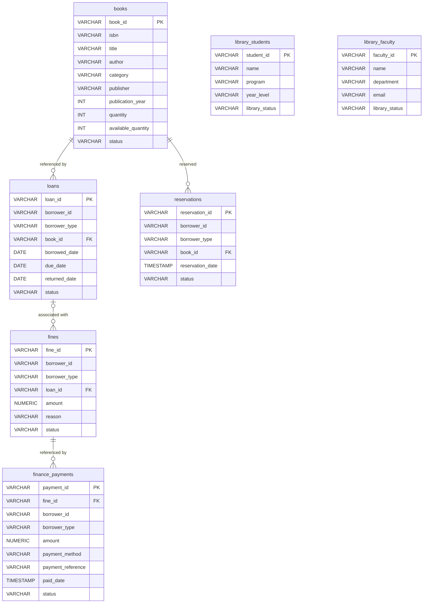

# Data Model

## 1. Overview

The Library Management System backend uses PostgreSQL as its relational database.

The database schema is defined in:

`server/database/library_schema.sql`

The database contains seven main tables:

- `books`
- `library_students`
- `library_faculty`
- `loans`
- `reservations`
- `fines`
- `finance_payments`

The schema defines primary keys, foreign keys, check constraints, and indexes to maintain data integrity and improve query performance.

## 2. Entity Relationship Diagram (ERD)

The following ERD shows the seven database tables, their columns, primary keys (PK), foreign keys (FK), and the relationships defined in the PostgreSQL schema.

### Relationship Explanations

- **Books and Loans:** One book can be referenced by multiple loan records. Each loan references one book.
- **Books and Reservations:** One book can be referenced by multiple reservations. Each reservation references one book.
- **Loans and Fines:** A loan can have multiple associated fines. A fine may have no loan reference because `fines.loan_id` is nullable.
- **Fines and Finance Payments:** One fine can be referenced by multiple payment records. Each payment references one fine.

### Borrower References

The `loans`, `reservations`, `fines`, and `finance_payments` tables contain `borrower_id` and `borrower_type`.

The `borrower_type` field accepts `STUDENT` or `FACULTY`. These fields logically identify a borrower from either `library_students` or `library_faculty`, but the database schema does not define foreign-key constraints connecting these fields to those tables.

## 3. Table Descriptions

| Table | Purpose |
|---|---|
| `books` | Stores book details, quantities, availability, and publication information. |
| `library_students` | Stores student information used by the Library module. |
| `library_faculty` | Stores faculty information used by the Library module. |
| `loans` | Records book borrowing and return information. |
| `reservations` | Records book reservation requests and their statuses. |
| `fines` | Stores fines, amounts, reasons, and payment statuses. |
| `finance_payments` | Stores payment details associated with fines. |

## 4. Primary Keys and Foreign Keys

Primary keys uniquely identify records in each table. Foreign keys connect records between tables and enforce referential integrity.

| Table | Primary Key | Foreign Key |
|---|---|---|
| `books` | `book_id` | None |
| `library_students` | `student_id` | None |
| `library_faculty` | `faculty_id` | None |
| `loans` | `loan_id` | `book_id` references `books.book_id` |
| `reservations` | `reservation_id` | `book_id` references `books.book_id` |
| `fines` | `fine_id` | `loan_id` references `loans.loan_id` |
| `finance_payments` | `payment_id` | `fine_id` references `fines.fine_id` |

## 5. Constraints and Indexes

The database schema uses check constraints to validate values such as:

- Book status and quantity.
- Student and faculty library status.
- Borrower type.
- Loan and reservation status.
- Loan dates.
- Fine amount and status.
- Payment amount, payment method, and status.

Foreign-key rules specify how related records behave when referenced records are updated or deleted.

Indexes are defined to support queries involving borrowers, books, statuses, and fine payment references.

Refer to `server/database/library_schema.sql` for the complete column definitions, constraints, and index declarations.

## 6. API and Data Model Consistency

The API specification is maintained in `server/openapi.yaml`.

The API documentation and database schema should remain consistent regarding identifiers, fields, data types, and validation rules. API response properties may use different naming conventions from database columns when the backend maps between them.

For example, the books API may expose camelCase properties such as `bookId`, `publicationYear`, and `availableQuantity`, while the database uses snake_case column names.
