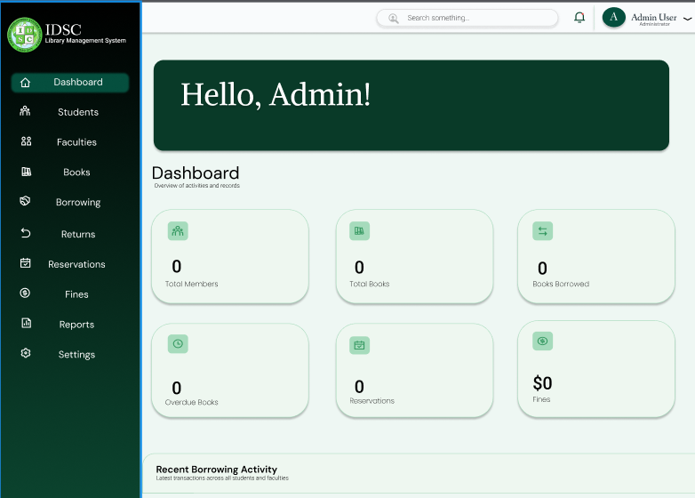
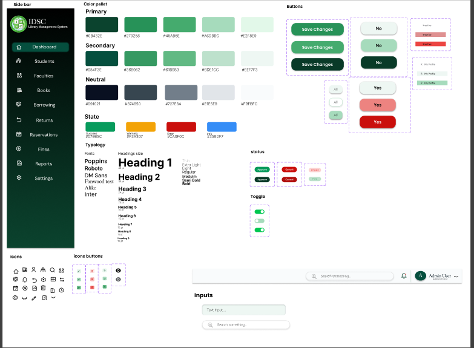
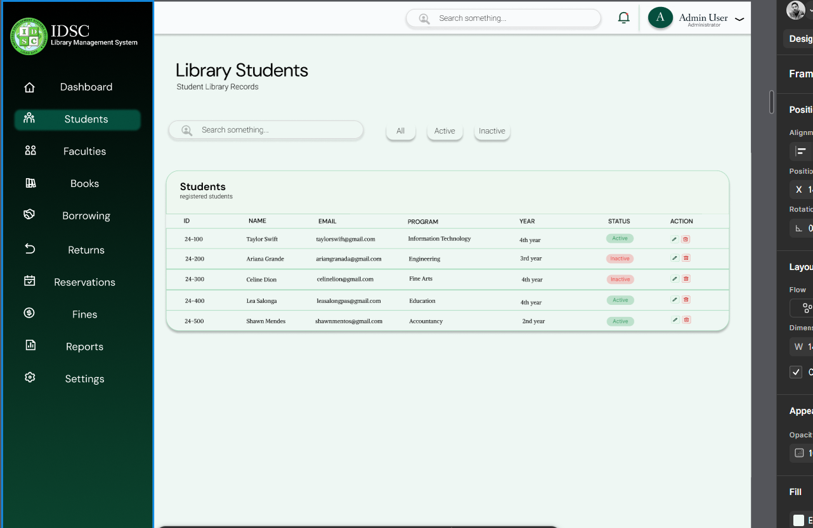
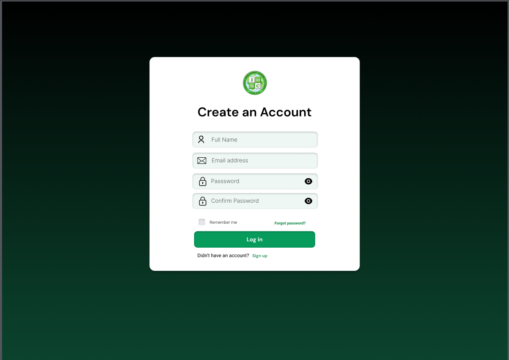
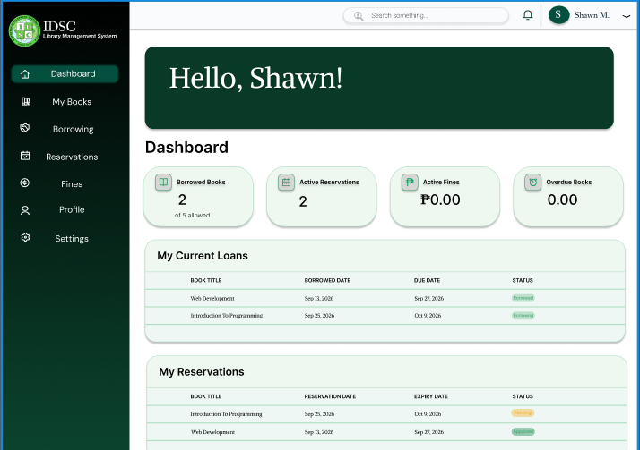

# Library Module Design System

## 1. Purpose

This document describes the visual design system and interface conventions used by the Library Management System prototype. It documents the shared Figma design reference, navigation, color palette, typography hierarchy, reusable interface components, status indicators, and identified Library module screens.

## 2. Shared Design Reference

- **Design system board:** [Library Management System — Figma](https://www.figma.com/design/WZ9KzDGJjEfuc3BAhKxhdZ/Project-SIA?node-id=0-1&p=f&t=A8HVlwdBxxbNCdeq-0)
- **Prototype reference:** [Library Management System — Prototype](https://www.figma.com/design/WZ9KzDGJjEfuc3BAhKxhdZ/Project-SIA?node-id=19-98&p=f)

The Figma design is the visual reference for the Library module. The interface follows a modern administrative dashboard style, with green as the primary brand color, a white content area, neutral backgrounds, rounded controls, and line-style icons.

## 3. Overall Layout and Navigation

The dashboard uses a vertical, dark-green sidebar with rounded corners. The EDSC logo and Library Management System label appear at the top. Navigation labels are white, and the active item is distinguished by a lighter-green highlight.

The sidebar contains the following navigation items:

1. Dashboard
2. Students
3. Faculties
4. Books
5. Borrowing
6. Returns
7. Reservations
8. Fines
9. Reports
10. Settings

The main content area uses a clean layout with generous spacing. The top navigation bar includes a search field, a notification bell with a green indicator, and a user avatar with a name and dropdown arrow.

## 4. Color Palette

The design-system board groups colors into primary, secondary, neutral, and status colors.

| Color group | Visual characteristics | Intended use |
|---|---|---|
| Primary | Dark emerald or forest green through pale mint | Main brand elements, primary actions, active navigation, and selected controls |
| Secondary | Softer and lighter green shades | Supporting interface elements, secondary emphasis, and subtle backgrounds |
| Neutral | Near-black navy, slate gray, light gray, and almost-white shades | Text, borders, backgrounds, and less prominent elements |
| Success | Green | Successful actions and positive statuses |
| Warning | Amber or orange | Warnings and attention-required states |
| Error | Red | Errors and destructive actions |
| Information | Blue | Informational messages and indicators |

The exact hexadecimal values of the color swatches are not legible in the available design reference. This document therefore records the visible color families without assigning unverified color codes.

## 5. Typography

The design-system board presents a sans-serif typography system with a clear hierarchy:

- Heading 1: Largest heading for primary page titles.
- Heading 2: Secondary section headings.
- **Heading 3: Smaller subsection headings.
- Heading 4 and subsequent levels: Supporting headings and lower-level content.
- Body text: Regular text used for descriptions, labels, and page content.
- Caption text:** Smaller supporting text used for secondary information.

The font-name samples are not sufficiently legible to identify the exact typeface reliably. The design should retain a consistent sans-serif appearance and a clear distinction between headings, body text, and captions.

## 6. Buttons and Actions

Buttons use rounded corners and consistent visual styling.

| Component | Appearance and purpose |
|---|---|
| Primary button | Filled green background with white text for main actions, such as Save Changes |
| Dark-green button | Darker green variant for stronger emphasis or an alternate interaction state |
| Secondary button | Light or outlined appearance with dark text, such as No |
| Confirmation buttons | Green Yes and light No buttons for ordinary confirmations |
| Destructive action button | Red styling for actions that can remove or delete data |
| Icon button | Compact button containing an icon, with green, red, or neutral variants |

Buttons should have clear action labels. Destructive actions should be visually distinguishable from ordinary actions so users can recognize potentially irreversible operations.

## 7. Inputs, Search, and Toggle Controls

### Text Inputs

Text inputs have rounded corners and light-green or gray borders. Placeholder examples include "Type here…" and "Search…".

### Search Field

The top navigation includes a rounded search field with a magnifying-glass icon. Search controls should remain visually consistent wherever they appear.

### Toggle Switches

Toggle controls use a green track in the enabled state and a white circular knob. Their appearance should communicate whether a setting is enabled or disabled.

### Notification and User Controls

The top navigation includes a notification bell with a green indicator and a circular green user avatar with a dropdown arrow.

## 8. Icons and Reusable Components

The design-system board uses small outline icons for common interface actions and features, including books, users, calendars, search, settings, notifications, editing, and deletion.

Reusable interface components include:

- Sidebar navigation items
- Top navigation and search
- Primary and secondary buttons
- Confirmation and destructive-action buttons
- Text inputs and search fields
- Toggle switches
- Icon buttons
- Status badges
- User avatar and dropdown control
- Warning and confirmation notifications

Components should use consistent spacing, corner rounding, icon treatment, and color conventions throughout the interface.

## 9. Status Badges

Status badges are compact, pill-shaped labels. The design reference shows green, dark-green, red, and pink or light-red variants.

| Visual variant | General visual meaning |
|---|---|
| Green | Positive or successful state |
| Dark green | Emphasized or alternate positive state |
| Red | Error, overdue, or potentially destructive state |
| Pink or light red | Softer warning or negative-state treatment |

Library-related statuses may include availability, borrowing, overdue, and reservation states. The precise label-to-color mapping should follow the actual prototype and should not be inferred from color alone.

## 10. Identified Prototype Screens

The following screens and interface areas have been identified from the prototype review.

| Screen or area | Purpose |
|---|---|
| Login page | Allows a user to sign in |
| Registration page | Collects registration information, including the user's full name |
| Main dashboard | Provides the main administrative landing page |
| Student management | Displays or manages student records |
| Student editing | Allows an existing student's information to be edited |
| Student deletion or confirmation | Represents the student-removal action or its confirmation |
| Faculty management | Displays or manages faculty records |
| Warning notification | Communicates a warning or asks the user to confirm an action |
| Shared navigation | Provides access to the module's navigation destinations |

The sidebar labels describe navigation destinations. They should not automatically be treated as separate, verified screen names. Likewise, a delete button or warning dialog may be a component within a page rather than a standalone screen.

## 11. Interface Consistency and Accessibility

The following conventions summarize the design system:

- Use green consistently for primary actions and active navigation.
- Use neutral colors to keep content readable and the layout uncluttered.
- Use red styling to distinguish destructive actions from ordinary actions.
- Keep button shapes, input borders, spacing, and icon styles consistent.
- Use a clear typography hierarchy to distinguish page titles, sections, and supporting information.
- Use descriptive labels for actions instead of relying on icons alone.
- Make warning and confirmation messages understandable before a user proceeds with a destructive action.
- Do not rely on color alone to communicate a status; retain a readable text label.

## 12. Design Reference and Maintenance

The shared Figma design and prototype links in Section 2 are the visual references for this document. If the design changes, update the documented navigation, component descriptions, status conventions, and screen inventory to match the revised prototype.

The backend endpoint mapping belongs in the architecture and API documentation. A screen should be associated with a specific endpoint only when that relationship has been verified against the API contract or implementation.

## 13. Prototype Screenshots

The following screenshots document selected views of the Library Management System prototype. They are stored in `docs/images/` and embedded below for convenient review.

### Admin Page

### Main Design Reference

### Dashboard

### Registration Form

### Student Page

